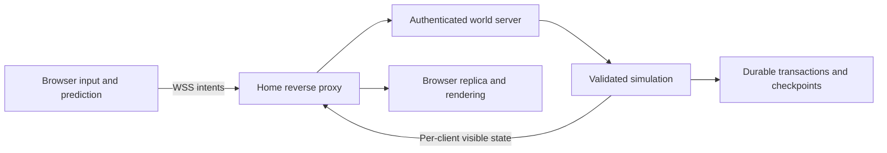

# Browser, multiplayer and home-server design

Version 1.0 · September 16, 2026 · Part of the [GDD](GDD.md).

This is a proposed architecture with measurable gates, not implemented software or a claim about Diego's unmeasured hardware. No ports, firewall rules, services, domains or paid subscriptions are configured by this documentation task.

## 1. Stack and boundaries

| Layer | Initial choice | Reason / boundary |
|---|---|---|
| Client | TypeScript, Vite, Babylon.js | Browser-native 3D and code-driven workflow; no Unity/Unreal editor |
| Rendering | WebGL 2 baseline; optional WebGPU later | Broad compatibility target; capability-test the actual device |
| UI | HTML/CSS accessible overlays plus canvas HUD elements where needed | Scalable text, keyboard focus and straightforward menus |
| Server | TypeScript on an active Node.js LTS release | Shared data/types and approachable single-process home hosting |
| Multiplayer | Colyseus room/session lifecycle over WSS | One persistent world room; application validates every action |
| Simulation | Pure shared TypeScript rules with a server-owned world | Rendering is a consumer, never an authority |
| Collision | Shared capsule/heightfield/static primitive queries | Start with constrained terrain/building colliders; no general rigid-body world |
| Persistence | SQLite transactions, write-ahead logging, versioned snapshots/journal | One server writer, atomic transfers, local backup and restore |
| Edge | Caddy HTTPS static hosting and WSS reverse proxy | A single public origin, local backend bound to loopback |
| Assets | glTF, compressed textures, manifest hashes | Downloadable versioned content with budget enforcement |

Babylon lists both WebGL and WebGPU support. This motivates the choice, but browser compatibility still requires testing. [Babylon specifications](https://www.babylonjs.com/specifications/). Colyseus supports server-owned state synchronization; it does not automatically supply this game's validation, durable persistence or interest/privacy rules. [Colyseus state synchronization](https://docs.colyseus.io/state).

**M0 dependency check (2026-09-16, npm registry):** the client package this document originally called `colyseus.js` was renamed; the current browser SDK is `@colyseus/sdk`. `colyseus.js` stopped at 0.16.22 (last published 2025-10-22) on `@colyseus/schema` v3, while the server package `colyseus`/`@colyseus/core` is now at 0.18.x on `@colyseus/schema` v5. Pairing the old client name with the current server major would desynchronize the schema wire format. Pinned M0 versions: server `colyseus` 0.18.6 (`@colyseus/core` 0.18.14), client `@colyseus/sdk` 0.18.2, shared `@colyseus/schema` ^5.0.8 on both sides; `@babylonjs/core` 9.26.2 (modular package, not the `babylonjs` UMD bundle, for tree-shaking against the client transfer budget); Vite 8.3.0; TypeScript 7.0.2; Vitest 5.0.1; `better-sqlite3` 13.0.3; Node.js 22 LTS (verified locally at v22.15.0). Re-check this pairing before M0 exits; do not let a later `npm install` silently pull `colyseus.js` back in. A graphical scene editor is optional asset tooling, never necessary for game development. Terrain comes from an authored heightfield, JSON placements and generated collision/nav data; Blender may prepare meshes without running a game engine editor.

If shared custom collision cannot pass slopes, steps and correction tests in the M0 timebox, evaluate a cross-runtime WASM physics library before expanding features. That is a measured architecture decision, not permission to maintain two incompatible controllers. A framework transport change must pass the same external-browser gates.

Proposed repository layout when implementation starts:

```text
apps/client/              rendering, UI, input, audio, predicted local controller
apps/server/              world room, persistence, sessions, administration
packages/sim/             inventory, combat, survival, crafting, world rules
packages/protocol/        command/event schemas, versioning, serialization
packages/content/         validated item/recipe/loot/world data
assets/source/            authoring sources and license records
assets/runtime/           optimized distributable files
tools/                    content validation, asset build, world authoring
tests/                    rule, integration, network, persistence, browser tests
ops/                      example config and operating scripts, no secrets
docs/                     this GDD and subsequent decision records
runtime/                  ignored local database, keys and generated state
```

## 2. Authority and command processing



The client sends intent: movement axes, yaw/pitch, action buttons, target ID, slot ID and expected inventory revision. It never submits trusted position, damage, item creation, craft completion, loot generation, door ownership or blueprint state. Server validation checks authentication, current session, life state, command sequence, schema, action rate, range, line of sight, cooldown, permissions and available resources.

Process discrete commands in received order at a tick boundary. Every economically meaningful action has a unique `(accountId, sessionEpoch, sequence)` transaction key. Persist accepted outcomes with their inventory/world changes before reporting success. Retries return the stored outcome, not another item. A client timeout is not evidence that an operation failed.

Example take-item transaction: validate current container revision and access → decrement source → increment destination → advance both revisions → persist one transaction → publish result. Reject the second competing take with refreshed slots. Placement similarly consumes its item and creates its piece atomically; death and container destruction move contents exactly once.

Proposed contracts:

```text
Command: protocolVersion, worldGeneration, sessionEpoch, sequence,
         clientTick, actionType, boundedActionPayload
Result:  sequence, accepted, reasonCode, serverTick, affectedRevisions
Item:    instanceId, definitionId, quantity, condition?, maxCondition?,
         loadedAmmo?, attachments?, schematicPayload?, remainingBurnTicks?
Entity:  entityId, generation, archetype, authoritativeTransform, components
Save:    schemaVersion, contentVersion, worldId, worldGeneration,
         checkpointTick, journalSequence, randomState, persistentEntities
```

Stable item/entity IDs are never recycled within a world generation. References to destroyed or prior-wipe entities fail closed. Runtime definitions validate against a schema; cross-file content references must resolve before the world loads. Random loot/spawn results are recorded or derive from persisted RNG state, so restarts cannot reroll a claimed crate.

## 3. Simulation and network budget

| Budget | Starting target |
|---|---|
| Simulation | 20 fixed ticks/s, 50 ms timestep |
| Movement input | Up to 20 messages/s, bounded bundling of recent inputs |
| Nearby movement snapshots | 10/s, with authoritative tick and acknowledged input |
| Distant simulation | AI decisions 2/s; locomotion integrates at 20 Hz when active |
| Interest | 150 m for dynamic entities; 300 m for buildings/large props |
| Sound | Server event radius may exceed render interest; send cue without private inventory |
| Client interpolation | Initially 100 ms; tune with measured jitter |
| Rewind | Up to 200 ms of player hitbox and dynamic-door history |
| State send target | 30 KB/s average per client, excluding initial assets and voice |
| Per-client send cap | 60 KB/s sustained; prioritize threats/nearby state |
| Server tick target at 16 players | p95 below 25 ms, p99 below 45 ms |
| Connection | Play target RTT ≤150 ms, jitter ≤30 ms; visible warning above 200 ms |

Local movement predicts using the same movement rules; reconcile from acknowledged server states and replay pending inputs. Other actors interpolate. Combat damage, inventory, health and placement remain authoritative; speculative muzzle flash or ghost placement must be visually reversible.

Hitscan rewind uses bounded, server-derived timing with capped client interpolation compensation; a forged old timestamp cannot expand the window. Verify ammo, fire interval and origin against the shooter's accepted history. Rewind target capsules and moving doors together; permanent geometry is checked normally. For newly created/destroyed cover, conservatively block a shot when either the historical or current solid state obstructs it. Reject future, excessively old and duplicate shot requests. High latency beyond the rewind cap remains disadvantaged; it cannot be made perfectly fair.

Relevance is both a bandwidth and information rule. Nearby public geometry is replicated; hidden container contents, private schematics, account secrets and distant sleepers are not globally broadcast. Remote actor interest does not guarantee prevention of wallhacks against geometry/actors already sent. The goal is to reduce exposed information and reject impossible actions, not promise cheat elimination.

The browser WebSocket API lacks built-in backpressure. [MDN WebSocket](https://developer.mozilla.org/en-US/docs/Web/API/WebSocket). Bound application queues and payload sizes, monitor buffered bytes, coalesce unsent movement before encoding, and disconnect a persistently stalled client before memory grows indefinitely. Reliable TCP head-of-line delays remain a tradeoff. If 20 Hz input over WSS fails the loss/jitter gates, investigate transport changes during M0, not after content completion.

Do not globally synchronize a giant room object containing the entire map and every inventory. Keep simulation separate from bounded per-client views; use framework filtering only after measuring its cost and privacy behavior. Concretely: the Colyseus room's `@colyseus/schema` state carries only public, interest-scoped fields per client (nearby entity transforms, health/condition visible at range, public container existence) built from the authoritative simulation each tick; it is not a mirror of the whole world object graph. Private data — a container's contents, another account's inventory, schematic payloads, recovery/auth material — is never placed on that shared schema and instead travels through targeted one-off messages sent only to an authorized client after a server-side access check. Initial snapshots are chunked and acknowledged, with a loading state until required collision and authoritative state are ready.

## 4. Capacity and browser performance

Minimum test target: a Windows laptop with 8 GB RAM and an integrated GPU supporting WebGL 2, 720p low at 30 FPS. Recommended test target: 16 GB RAM and GTX 1060-class or comparable GPU, 1080p medium at 60 FPS. These are unverified goals; record actual test devices, OS, browser versions and drivers in each release report. Safari/macOS and Linux validation is required before advertising those platforms as supported.

| Client budget | Target |
|---|---|
| Initial compressed transfer to play slice | ≤30 MB |
| Full map/assets downloaded over session | ≤100 MB compressed |
| Browser memory after 30 minutes | ≤800 MB, no continuing growth >10 MB/10 min after warm-up |
| Visible triangles / draw calls, low | ≤200k / ≤150 in reference view |
| Active dynamic lights, low | Sun plus nearest four local lights; no point-light shadows |
| Main-thread long tasks | No >100 ms task during ordinary movement/combat after load |
| Play readiness | ≤20 s on measured 25 Mbps down / 50 ms RTT, excluding first account creation |

At 25 Mbps, a full 30 MB uncached transfer alone is about 9.6 seconds before overhead; decoder, network and scene-creation time must fit the remaining budget. Reduce startup content rather than concealing loading in a blocked screen. Low settings may reduce decoration, shadows, texture size and particles; cover colliders and meaningful silhouettes remain equivalent. No tall grass advantage from hiding only cosmetic mesh that higher settings falsely imply is cover.

Home upload model: `players × averageKBps × 8 / 1000` Mbps. At 16 × 30 KB/s, game state is 3.84 Mbps; reserve ×2 headroom = 7.68 Mbps before HTTP asset traffic and voice. A provisional 15 Mbps usable upload target is a test starting point, not a guarantee. Cap concurrent asset downloads/rate so one joining player cannot starve combat traffic. Cache immutable assets in the browser; an optional CDN can later serve static files without owning simulation.

Provisional server allowance: modern 4-core CPU, 8 GB available RAM, SSD, wired network. Simulation process budget ≤2 GB RAM and one fully utilized core at load; measure on Diego's actual computer while it is also used normally. Reduce accepted player slots when real measurements miss gates. Load test bots are necessary but cannot replace human movement/voice/browser tests.

## 5. Accounts and session identity

Private prototype uses host-created invite codes. Joining creates a stable account with a server-generated recovery secret shown once; the player saves it. Store only a cryptographic hash of the recovery secret and password/invite material, never plaintext secrets in logs. Authenticate over HTTPS and issue a short-lived session plus a secure, HttpOnly, same-site refresh cookie. Do not put durable credentials in URLs or localStorage.

One active gameplay session per account. Reconnect replaces the older session epoch after authentication, so delayed old packets cannot mutate state. Anonymous display-name-only identity is insufficient: players must recover property after browser storage is cleared. Browser changes use the recovery flow; a fresh account does not inherit another player's name-based ownership. A documented host recovery process can revoke/reset credentials with an audit entry.

Public signup is out of scope for the first private test. For a public release, choose and threat-model registration/password reset before opening access; this design does not silently depend on a paid identity provider. Admin authentication is separate from player authentication.

Pointer lock must follow a deliberate interaction and correctly handle unlock and permission failures. [MDN Pointer Lock](https://developer.mozilla.org/en-US/docs/Web/API/Pointer_Lock_API). Microphone capture needs permission and HTTPS in normal deployment. Denial leaves text and all gameplay functional. [MDN microphone capture](https://developer.mozilla.org/en-US/docs/Web/API/MediaDevices/getUserMedia).

## 6. Voice transport

Use proximity voice over WebRTC with signaling authenticated through the game session. Send only the currently authorized nearby voice peer list. Each active listener subscribes to at most four nearest talkers; one speaker sends to at most four nearby recipients, chosen consistently by the server. This bounded peer mesh is a deliberate small-server compromise; larger groups need an SFU and a separate capacity decision.

ICE/STUN alone cannot guarantee connectivity across every NAT. Full voice acceptance requires a working TURN relay for restrictive networks; provision on the home ingress only if reachable, otherwise use an explicitly chosen external relay. Text fallback remains available. Voice never carries gameplay authority. A session reconnect rebuilds peer permissions; mute does not change game simulation. Do not record voice by default. [WebRTC TURN guidance](https://webrtc.org/getting-started/turn-server).

At an assumed 24 kbps audio payload, four remote deliveries cost roughly 96 kbps per speaking client before protocol overhead. If TURN relays through home, budget both receive and forwarding load. Measure crowded encounters and simultaneous talkers, not only one successful microphone test. If external relay cost/connectivity is unresolved, voice is a named full-release blocker, not marked complete because local LAN voice works.

## 7. Persistent world and crash semantics

Store account identities, permissions and known recipes; living/dead/sleeper player state; items including condition/loaded ammo; structures, HP and support; containers; stations and their processing counters; node depletion/respawn; wildlife/carcass state; loot RNG outcomes; active projectiles/explosives/events; world clock/weather; cooldowns and decay timestamps. Persist moderation state separately enough to survive world wipes.

Two durability classes:

1. **Committed economy/lifecycle transactions:** item transfers, consume, craft output, placement, research, death, destructive container spills, charge arming and event delivery are committed atomically before success is acknowledged. Include all affected entity and player state. No acknowledged item operation may be replayed into duplication.
2. **Continuous state checkpoints:** movement, ongoing survival values, AI and remaining timer progress checkpoint every 5 seconds, without overwriting newer committed transaction state. Replay the ordered event journal after a checkpoint when recovering. Nontransactional position/time can roll back up to 5 seconds on hard failure; a death/loot transaction already committed cannot be undone by that checkpoint rollback.

Use a single writer and monotonically ordered persistence sequence; transaction events and checkpoints must reference the same simulation order. A checkpoint is one consistent image or an equivalent versioned incremental snapshot. In-memory mutation is applied in a way that can be recovered from the committed journal; publishing before commit is prohibited for class 1. Batch within one tick only when each action's outcome remains atomic and latency stays acceptable.

Clean shutdown sequence: stop new joins → announce restart if planned → stop accepting player actions → finish or roll back pending transaction writes → checkpoint the world and remaining timers → close sessions → close database. On unexpected storage failure, stop mutations and fail the world closed; do not continue awarding unverifiable loot.

On crash restart: validate schema/content versions and integrity → load checkpoint → replay later committed events idempotently → convert previously connected players to sleepers → resume the persisted world tick → open joins. Do not infer simulation time from elapsed wall-clock time. OS sleep/resume discards large timing gaps; time does not fast-forward. Finite catch-up is limited to 250 ms during ordinary scheduler stalls, then report overload and slow the simulation instead of a lethal fast-forward.

SQLite is an implementation choice, not a guarantee by itself. Test transaction journal, fsync settings, forced termination, full disk, interrupted migrations and restore with actual files. Use the database's consistent backup API/checkpoint method; copying a live main database while ignoring its WAL is not an acceptable backup. [SQLite backup API](https://www.sqlite.org/backup.html), [SQLite WAL](https://www.sqlite.org/wal.html). Back up at startup, every 30 online minutes and before upgrades/wipes. Retain 24 rotating backups plus the latest seven distinct daily backups; verify at least one restore to a separate directory before each public session series. An off-device copy is recommended for disk-failure protection and is not configured by this GDD.

No scheduled automatic wipe in the first playtest. Offer world wipe (geometry/items reset, identity/recipes persist) and full progression wipe (also learned recipes reset). Host must select the mode explicitly, preview affected world ID, back up, and announce. Schema migrations are versioned and one-way only after a backup; unsupported future saves refuse to load. Content IDs removed by a migration need explicit replacement/removal rules.

## 8. Home internet ingress and availability

Preferred direct topology:

```text
Remote browser → HTTPS/WSS public domain:443 → home router → Caddy
              → static client and local Node server (loopback only)
```

Configure a domain or dynamic-DNS record pointing to a reachable home address, a reserved LAN address for the host, and router/firewall ingress to the reverse proxy. Certificate validation and HTTP redirects may additionally require port 80 for the selected Caddy challenge; a DNS challenge is an alternative. Caddy supports WebSocket proxy upgrades and automatic HTTPS, but it cannot make an unreachable CGNAT host publicly reachable by itself. [Reverse proxy](https://caddyserver.com/docs/caddyfile/directives/reverse_proxy), [Automatic HTTPS](https://caddyserver.com/docs/automatic-https).

Discovery checklist before choosing deployment: actual external IP versus router WAN address, CGNAT/double NAT, ISP inbound restrictions, public IPv4/IPv6 reachability, router ownership, upload headroom, sleep settings and dynamic address behavior. Test from a cellular hotspot or another household. Success from the host's own browser or LAN is insufficient; NAT loopback can also fail locally even when outside access works.

If direct ingress is unavailable, use a reverse tunnel that supports long-lived WebSocket connections, or a small reachable relay that forwards traffic to home over an outbound connection. Verify connection limits, idle timeouts, bandwidth, latency, restart behavior and applicable service terms before selection. Simulation and world files remain at home. A private VPN is acceptable for friends-only testing but adds player installation and does not satisfy the unrestricted browser-link goal.

A tunnel solves reachability, not uptime: machine off, sleeping, server crashed or internet disconnected still means unavailable. A public IP is not required if a suitable tunnel is used; paid hosting is not automatically required. No specific free plan is promised. The selection remains an M0 test outcome.

## 9. Host operating flow

Provide one documented start command/script and one graceful stop command after implementation. Startup checks configuration, save integrity, protocol/content versions, available disk, listen ports and ingress health; it does not silently open firewall ports or start a new empty world after a save error. Run Node and proxy as background services with explicit logs and a single-instance world lock. Starting the server must not depend on a browser tab staying open.

Operator sequence:

1. Start host services; confirm the intended world ID, database and player cap.
2. Validate `/health` for process liveness and an authenticated readiness report for save/ingress status; do not publish private machine details.
3. Connect externally and perform one interaction before inviting players.
4. Watch tick time, RSS, outbound bandwidth, save latency and connection errors during the session.
5. Announce a planned stop, reject joins, save and close cleanly.
6. Review backup outcome and test restart before an upgrade.

Administration is available only on loopback or an authenticated private management path. Required operations: status, announce, save, backup, graceful stop, list sessions, whitelist, kick, ban, unban, inspect transaction ID, restore to a separate test world, and deliberate wipe. No unauthenticated browser console or public database listener. Accounts and configuration are not committed to Git.

## 10. Abuse, limits and diagnostics

Require same-origin gameplay by default; validate WebSocket Origin, session and protocol. Escape names/chat as text. Size limits: movement message ≤1 KB, discrete action ≤4 KB, chat ≤200 characters; total client action ceiling 40/s with separate fire-rate and interaction checks. Chat burst limit three messages per five seconds. Rate-limit authentication, joins and recovery attempts by both identity and network source without treating an IP as one unique human.

Apply bounds to requested coordinates, numbers, arrays, integer counts and floating-point values; reject NaN, infinity, stale IDs and impossible movement. Never evaluate client-supplied code, filesystem paths or item definitions. Log validation reason counts and suspicious rate patterns; do not auto-ban solely for one latency correction. Host can review a specific event stream.

Browser code is inspectable. Server validation prevents impossible inventory/damage actions but cannot fully prevent aim assistance, overlays or information abuse. Home-hosted public exposure also cannot absorb arbitrary DDoS traffic. Private whitelist is the first release boundary; public opening depends on measured capacity and a considered ingress/abuse plan.

Operational metrics: connected players, tick p50/p95/p99, per-client bytes, queued messages, persistence latency, memory, disconnect reason, aggregate source/sink counts and failed validation totals. Default detailed gameplay log retention is seven days, operational errors thirty; avoid chat body/voice retention unless deliberately enabled for a private test. Export diagnostics with tokens and private addresses redacted.

## 11. Non-negotiable engineering acceptance

Two independent clients must observe the same inventory and world after simultaneous actions, death, reconnect and process kill. Off-host connection must be demonstrated. Secret inventory must not appear in unrelated client's packets. Server-off hours must not advance game timers. A saved explosive must not duplicate or disappear simply because the host restarts. No architecture diagram or unit-test count replaces these integrated proofs. Detailed cases and milestone ownership are in [PRODUCTION](PRODUCTION.md).
